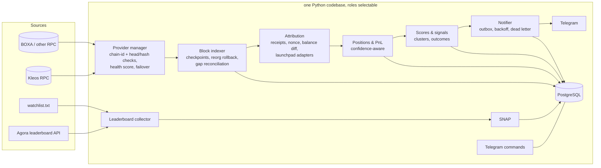

# Architecture & code audit — v0.1 (commit `ea11ad4`)

Scope: every module in `agora_tracker/`, `tests/`, Dockerfile, compose and CI, audited against
the production-readiness mission. Line numbers refer to `ea11ad4`.

**Method.** Findings marked **[proven]** were first reproduced by a script run against
`ea11ad4` (each assertion failed, confirming the bug), then fixed; the regression tests in
`tests/test_p0_regressions.py` (named after the finding IDs) assert the fixed behaviour. Others are from code review.
No live RPC or Agora endpoint was reachable from the build environment, so nothing here is
verified against real Elysium data.

## Summary

| Severity | Count | Meaning |
|---|---|---|
| Critical | 3 | Silent data loss or fabricated financial data |
| High | 9 | Wrong results under realistic conditions, or network mixing |
| Medium | 11 | Degraded reliability / observability, wrong edge cases |
| Low | 5 | Cosmetic, minor inefficiency |

The core design (log-based ingestion, atomic range commit with the cursor, outbox for
Telegram) is sound. The problems are in **what happens when data is missing or
ambiguous**: v0.1 tends to guess and then present the guess as exact.

## Findings

### 1. Code quality & separation of concerns

| ID | Sev | Where | Finding |
|---|---|---|---|
| Q1 | Medium | `engine.py:100-121`, `db.py:95-135` | Engine calls `Store` static methods with a raw `sqlite3.Connection`; storage dialect leaks into business logic. Blocks a PostgreSQL port without touching the engine. |
| Q2 | Medium | `chain.py:118-205` | `scan()` fetches, attributes, classifies and resolves metadata in one 90-line function. Raw evidence (logs, tx, receipts) is discarded after classification, so nothing can be re-derived. |
| Q3 | Low | `__main__.py` | CLI, lifecycle loop and status/health helpers in one module. Acceptable at this size. |
| Q4 | Low | repo | No linter or type checker in CI. |

### 2. Transaction boundaries & crash recovery

| ID | Sev | Where | Finding |
|---|---|---|---|
| T1 | ✅ | `engine.py:100-121` | Events, positions, alerts and cursor commit in **one** transaction. A crash replays the range. Keep this. |
| T2 | High | `db.py:95-102`, `classify.py:26-27` | **[proven]** Event key includes `kind`. If a replay classifies a leg differently (e.g. balance history became available: `TRANSFER_OUT` → `SELL`), both rows are stored → double accounting. Key must be `(chain, tx, wallet, token)`. |
| T3 | Medium | `chain.py:53-71` | Token metadata is written outside the range transaction (harmless), but see C4. |

### 3. Event completeness & classification

| ID | Sev | Where | Finding |
|---|---|---|---|
| C1 | **Critical** | `chain.py:162-168` | **[proven]** If `eth_getTransactionByHash` fails or returns null, the event is skipped with a warning and the cursor still advances. The trade is lost permanently. |
| C2 | **Critical** | `chain.py:148-160, 181-183` | **[proven]** HYPE attribution uses the wallet's balance change over the whole block and counts only txs *with token flows*. Any other HYPE movement in that block (a plain HYPE send, a receipt from someone else) is attributed to the token tx and labelled exact. Repro: an airdrop arriving in the same block as an unrelated 5 HYPE payment is recorded as **BUY, 5 HYPE, approx=False**. |
| C3 | High | `chain.py:182-189`, `classify.py:47-52` | A tx not sent by the wallet can still become BUY/SELL. Only the wallet's own txs can spend its HYPE, so third-party txs (airdrops, escrow/limit-order fills, transfers) must not be confirmed trades. |
| C4 | High | `chain.py:53-71` | **[proven]** A transient `eth_call` failure caches `symbol=address prefix, decimals=18` permanently. Tokens with other decimals then show wrong amounts and prices forever. |
| C5 | High | `chain.py:169-176` | Missing receipt is treated as success with fee 0. Should be retried, not guessed. |
| C6 | High | `chain.py:94-103` | Every JSON-RPC error, including rate limits, triggers a recursive range split. Under rate limiting this multiplies requests instead of backing off. |
| C7 | Medium | — | No block hashes stored, no reorg detection, `confirmations: 0` default. Low risk with one sequencer, but re-genesis or provider divergence is undetected. (P2) |
| C8 | Medium | `chain.py:195-201` | Missing block timestamp stored as NULL; cluster logic then falls back to wall-clock time, mixing time bases. |
| C9 | Low | `chain.py:127-131` | Logs with `data` longer than 32 bytes are read correctly; non-standard tokens (rebasing, fee-on-transfer) are handled only because deltas are netted. Not tested. |

### 4. Native HYPE & PnL accuracy

| ID | Sev | Where | Finding |
|---|---|---|---|
| P1 | **Critical** | `engine.py:73-98` | Approximate events (`approx=True`) update positions and realized PnL exactly like exact ones. Results look precise but are not. |
| P2 | High | `engine.py:73-98` | `TRANSFER_OUT` leaves position quantity unchanged, so "full exit" never fires after a wallet moves part of a bag, and remaining-bag numbers are wrong. |
| P3 | Medium | `engine.py:83-91` | Sells larger than the tracked position book PnL only on the tracked part, but the message doesn't say part of the sale had unknown cost. |
| P4 | Medium | `engine.py:150-162` | Cluster signal counts *any* BUY, including dust below `min_trade_hype` and approximate buys. |
| P5 | Low | `engine.py:101` | Thresholds converted with float math (`min_trade_hype * WEI`). |

### 5. Leaderboard quality & failure handling

| ID | Sev | Where | Finding |
|---|---|---|---|
| L1 | Medium | `leaderboard.py:90` | **[proven]** `x or float("-inf")` sorts PnL `0` below negative PnL. |
| L2 | Medium | `leaderboard.py:102-116`, `__main__.py:54-79` | No pagination; a partial response (e.g. 20 rows) is accepted silently and produces mass "dropped out" alerts. |
| L3 | Medium | `db.py:80-92` | Snapshots overwrite the previous one; no ranking history. (P3) |
| L4 | ✅ | `__main__.py:57` | On failure the previous set is kept. Keep this. |

### 6. RPC performance, retries, failover

| ID | Sev | Where | Finding |
|---|---|---|---|
| R1 | High | `rpc.py:62-69`, `__main__.py:47-52` | Chain ID is verified only for the first URL at startup. Failover rotates to other URLs with no check → **silent network mixing** if any configured provider is on another chain. |
| R2 | ✅ | `rpc.py:79-111` | Batch responses are matched by request id, missing ids become per-item errors. Requirement already met. |
| R3 | Medium | `rpc.py:101-102` | One non-list batch response (e.g. a transient error object) disables batching for the life of the process. |
| R4 | Medium | `rpc.py:30-34` | Failover rotates on every transport error; no health score, latency tracking or head/hash comparison between providers. (P2) |
| R5 | Medium | `rpc.py:34`, `__main__.py:52,109` | Provider URLs are logged and sent to Telegram verbatim. Keyed URLs (`…/v2/<API_KEY>`) leak secrets. |
| R6 | Low | `rpc.py:63-66` | A non-dict single response raises `AttributeError` instead of `RpcError`. |

### 7. Duplicates, missing events, replay

| ID | Sev | Where | Finding |
|---|---|---|---|
| D1 | High | `__main__.py:81-97` | **[proven]** The cursor advances when no wallets are tracked (leaderboard down at first start and empty watchlist), permanently skipping blocks. |
| D2 | Medium | — | Wallets added later get no history backfill; their first sells show "PnL unknown". (P2) |
| D3 | ✅ | `chain.py:105-115` | Logs deduplicated by `(tx, logIndex)` across wallet chunks and sender/receiver queries. |

### 8. Telegram delivery

| ID | Sev | Where | Finding |
|---|---|---|---|
| N1 | Medium | `notify.py:69-80`, `db.py:162-172` | No backoff between attempts (retried every poll); after 10 failures the alert disappears from the queue with no dead-letter record or metric. |
| N2 | Medium | `notify.py` | An ambiguous failure (timeout after Telegram accepted the message) causes a duplicate send. Not documented. Inherent to Telegram's API; must be documented and bounded. |
| N3 | ✅ | `notify.py:43-49` | `retry_after` honoured; HTML parse failure falls back to plain text. |

### 9. Deployment, security, resources

| ID | Sev | Where | Finding |
|---|---|---|---|
| S1 | ✅ | Dockerfile | Non-root user, healthcheck, log rotation, memory limit, secrets via `.env`, `config/` git-ignored. |
| S2 | Medium | `docker-compose.yml` | `unhealthy` does not restart the container; Docker only restarts on exit. Healthcheck is informational. |
| S3 | Low | Dockerfile | Base image tag not pinned by digest; dependency versions are lower bounds only. |
| S4 | High | `notify.py:59-61` | `log.warning("Telegram send failed: %s", e)` logs the `requests` exception, whose text contains the request URL **including the bot token**. Found while fixing N1. |

### 10. Tests, CI, observability

| ID | Sev | Where | Finding |
|---|---|---|---|
| O1 | High | `tests/` | 7 tests, all happy-path. No tests for RPC failure, partial batch failure, failover, crash recovery, notifier failures, or any of the bugs above. |
| O2 | Medium | — | No metrics: RPC latency/errors, head lag, approximate-event rate, outbox backlog are invisible. `--status` is the only view. (P5) |
| O3 | ✅ | CI | Tests + image build + smoke test on every push. |

## Backward-compatible behaviour to preserve

1. CLI flags: `--config --once --dry-run --import-curl --discover --status --reset-cursor --health --health-max-age --log-level`.
2. `config.example.yaml` keys and defaults; secrets from `TG_BOT_TOKEN` / `TG_CHAT_ID`.
3. Watchlist file format (`0xaddr label`), followed regardless of rank.
4. Leaderboard keeps the previous set on failure; Agora is never required for watchlist tracking.
5. Replay of any block range is safe and never re-sends alerts.
6. Alert kinds and their Telegram format (icons, `#rank · label · address · PnL` header).
7. Contracts excluded from the leaderboard set; EIP-7702 delegated EOAs kept.
8. `docker compose up -d` deployment with state in a named volume.

## Requirements already satisfied (not to be rebuilt)

Batch results matched by request id (R2) · log dedup by `(tx, logIndex)` (D3) · atomic
range commit with cursor (T1) · `retry_after` handling (N3) · keep-previous-set on
leaderboard failure (L4) · endpoint discovery and cURL import · non-root container with
healthcheck and log rotation (S1).

## Proposed architecture

Delivery: P0 (this audit's Critical/High fixes) → P1 PostgreSQL foundation → P2–P5 as
GitHub issues with acceptance criteria.
