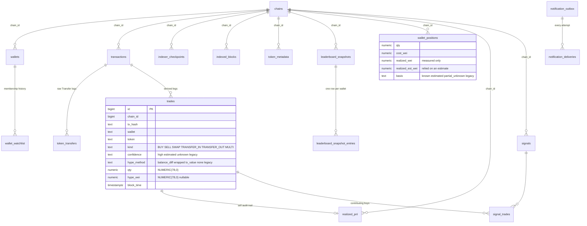

# Database design (PostgreSQL)

Schema source of truth: Alembic migrations in `agora_tracker/migrations/versions/`.
`agora_tracker/schema.py` mirrors them for queries; a test (`test_migrations_up_down_up_and_no_drift`)
fails if the two ever differ.

## ERD

## Key decisions

| Decision | Why |
|---|---|
| `NUMERIC(78,0)` for every on-chain integer | uint256 max is 1.16 × 10^77 (78 digits). Exact, no float. Signed PnL fits too. |
| `NUMERIC(24,6)` for Agora USD figures | Provider values are decimals; 10^18 USD at micro-dollar resolution. Stored via `Decimal(str(x))` so `0.1` stays `0.1`. |
| `TIMESTAMPTZ` everywhere | Block times and capture times in UTC, never local time. |
| Lowercase addresses with `CHECK` | One canonical form for joins; `address_checksum` column available for display. |
| `chain_id` on every chain-specific row, FK to `chains` | No accidental cross-chain mixing; a re-genesis can be a new chain row. |
| Unique `(chain_id, tx_hash, wallet, token)` on trades | Idempotent replay: one row per leg, whatever a later pass classifies it as. |
| Unique `(chain_id, tx_hash, log_index)` on transfers | Raw evidence deduplicated exactly as the node identifies logs. |
| `transactions` holds receipt fields too | Tx and receipt are 1:1; one table is simpler and keeps the FK target single. |
| No `wallet_position_history` table | Replaying `trades` + `realized_pnl` in id order reconstructs any past position exactly; a copy would only drift. |
| `realized_pnl` per sell, with `status` measured / estimated / unknown | Audit trail behind every PnL number; unknown cost stays unknown. |
| Leaderboard snapshots are append-only | Rank history for backtesting; degraded and failed collections are recorded too. |
| `wallet_enrollment` is evidence, not a watchlist | One row per wallet that was ever in an accepted (`ok`/`imported` and `complete`) top list: first/last seen, best/last rank, appearances, entries/exits, `in_top`. It is rebuilt from the append-only snapshots by `backfill_enrollment` (idempotent) and kept current incrementally; a test asserts both paths give identical rows. Incidental senders, recipients and pools never enter it. |
| Leaderboard membership, tracking eligibility, scan coverage are three records | `in_top` (membership) can flip freely; `status` (`active`/`excluded` + reason, i.e. eligibility) only changes by explicit policy (contracts); `wallet_scan_coverage` (which blocks were really scanned) is written by the scanner. Leaving the Top 100 never touches eligibility or coverage. |
| `leaderboard_membership_events` | ENTERED / EXITED against the previous accepted list, unique per (wallet, snapshot, kind): rank timeline and re-entry history without scanning 100k snapshot rows. |
| `wallet_scan_coverage` intervals | One open interval per scanned wallet. `live` intervals start at the scanner cursor + 1; `derived` ones were reconstructed once from watchlist timestamps and are approximate. A gap between intervals means trades were **not recorded**; the registry never implies otherwise. Private (manual/Telegram) wallets have rows too, so the table is not exposed. |
| `wallet_watchlist` rows are never deleted | `removed_at` + `status` keep the membership history (who was top 100 when). |
| Outbox `dedup_key` unique, deliveries logged separately | At-least-once delivery with a full attempt history. |

## Tables deferred to later migrations

The mission lists more entities. These are intentionally not created yet, because no code
writes them and empty tables add maintenance without value. Each is tracked as a GitHub
issue with its migration:

| Entity | Planned in |
|---|---|
| `rpc_providers` (health scores, latency) | #3 provider manager |
| `ingestion_runs`, `ingestion_errors` | #5 reconciliation job |
| `token_prices` | #14 signal outcomes |
| `wallet_scores`, `wallet_score_history` | #11 scoring |
| `wallet_clusters`, `cluster_memberships` | #12 funding-graph clustering |
| `signal_outcomes` | #14 outcome tracking |
| `alert_rules` | #15 Telegram commands / per-chat settings |

`transaction_logs` (all logs, not just Transfer) is deliberately not stored: the indexer only
requests Transfer logs. Launchpad adapters (#7) will add their own decoded-event tables.

## Concurrency

* One indexer per chain: `pg_try_advisory_lock(0x454C5953, chain_id)` on a dedicated session.
  If that session drops, the indexer stops (Docker restarts it and it re-acquires).
* Notifiers claim alerts with `SELECT … FOR UPDATE SKIP LOCKED`, so several can run.
* All writes for one block range happen in one transaction with the checkpoint.
